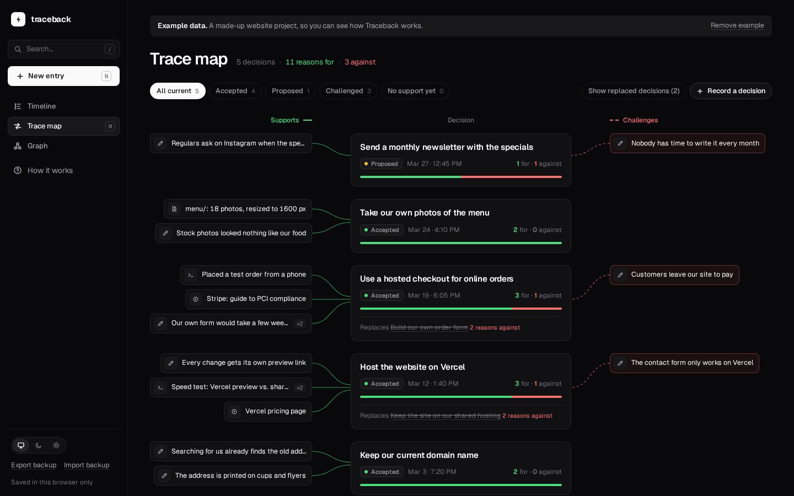
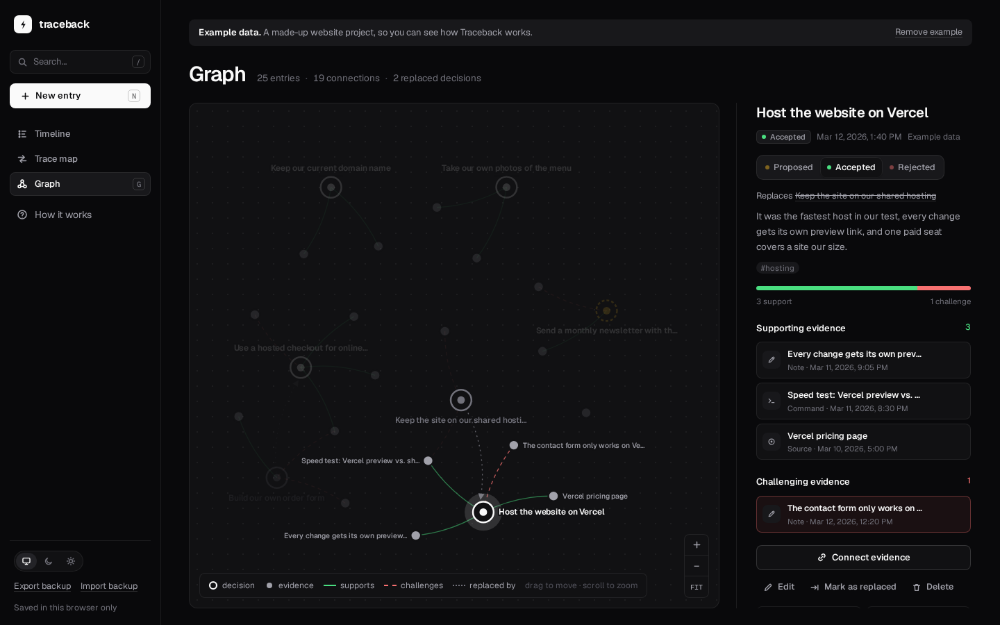
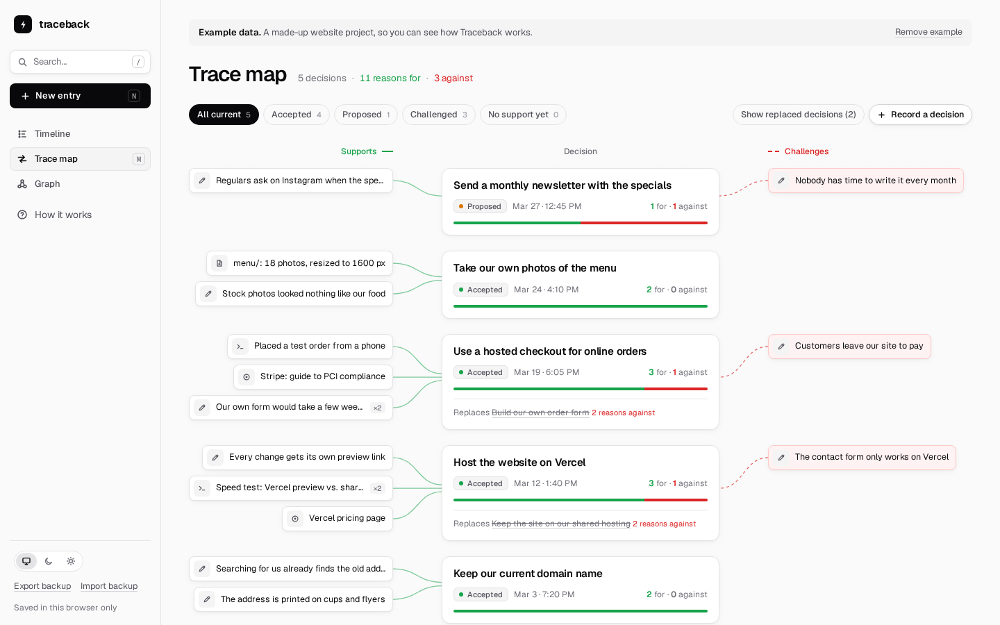

# Traceback

**Your work, with the *why* still attached.**

Traceback is a local-first evidence trail. You capture the sources, notes, commands and file changes you come across while working, record the decisions you make, and link each piece of evidence to the decisions it **supports** or **challenges**. Months later you can still answer "why did we do it this way?" — and export the answer as a Markdown or JSON bundle.

Everything stays in your browser. There is no account, no server and no telemetry; the app's Content-Security-Policy does not even allow it to make outside requests.



## Three ways to look at the trail

- **Trace map** (<kbd>M</kbd>, the default): one row per current decision. Evidence that supports it sits on the left, evidence that challenges it on the right, and the decisions it replaced appear inside its card with the reasons they were dropped. Evidence that is not connected to anything yet is listed at the bottom, so nothing gets lost.
- **Graph** (<kbd>G</kbd>): every entry and connection on one canvas. Rings are decisions, dots are evidence; teal lines support, dashed red lines challenge, dotted arrows point from a replaced decision to the one that replaced it. Select a node to bring its neighbourhood forward. Positions come from each entry's id rather than chance, so the same trail looks the same every time you open it, and adding an entry barely moves the rest.
- **Timeline** (<kbd>T</kbd>): everything you captured, newest first, filterable by type.





## Features

- **Five entry types**: source, note, decision, command, file change, with tags, links and verbatim quotes.
- **Decisions with a lifecycle**: proposed, accepted, rejected, replaced — including which decision replaced which.
- **Evidence for and against**: every link says whether the evidence supports or challenges the decision, and you can flip it later.
- **Edit in place**: change, reconnect or delete any entry from its details panel; a deleted entry comes back with **Undo**.
- **Dark and light**: follows your system's setting; pick Dark or Light in the sidebar to override it.
- **Search with operators**: `type:decision`, `#tag`, `status:proposed`, `is:unsupported`, `is:unlinked`, `is:challenged`, `"exact phrase"`. In the trace map a search also finds decisions through their evidence.
- **Coverage at a glance**: current decisions, reasons for and against, and evidence by type. Replaced decisions are never deleted; they stay in the trail, linked to the decision that replaced them.
- **Exports**: one decision as a Markdown or JSON bundle (UTC timestamps, quotes, links); the whole workspace as a JSON backup you can import again.
- **Browser extension** for Chrome, Brave and Firefox: capture the current page and selected text with one click or <kbd>Alt</kbd>+<kbd>Shift</kbd>+<kbd>K</kbd>.
- **Safe across tabs**: open Traceback in as many tabs as you like; no tab overwrites another's work.
- **Example data**: a made-up café building its website, added only when you ask and removed in one click.

### Keyboard

| Key | Action |
| --- | --- |
| <kbd>M</kbd> / <kbd>G</kbd> / <kbd>T</kbd> | Trace map / Graph / Timeline |
| <kbd>N</kbd> | Capture a new entry |
| <kbd>/</kbd> | Search |
| <kbd>?</kbd> | How Traceback works |
| <kbd>Esc</kbd> | Close the details panel |
| <kbd>+</kbd> / <kbd>-</kbd> / <kbd>0</kbd> | Zoom in, zoom out, fit the graph |

Each view has its own address (`#map`, `#graph`, `#timeline`), so the browser's back button and bookmarks work.

## Quick start

Requires Node.js 20 or newer.

```bash
npm install
npm run dev
```

Open <http://localhost:5173>. The port is fixed on purpose: browser storage belongs to an origin, and the port is part of the origin, so Traceback refuses to start on another port rather than show you an empty trail.

## Browser extension

1. Run Traceback with `npm run dev`.
2. **Chrome / Brave**: open `chrome://extensions`, enable *Developer mode*, choose *Load unpacked* and select the `extension/` folder.
   **Firefox**: open `about:debugging#/runtime/this-firefox`, choose *Load Temporary Add-on* and select `extension/manifest.json`.
3. On any web page, optionally select some text, click the Traceback button (or press <kbd>Alt</kbd>+<kbd>Shift</kbd>+<kbd>K</kbd>), add a note or tags, and choose **Capture source**.

The capture waits in the extension until a Traceback tab is open, then appears in your trail. If the app runs somewhere other than `http://localhost:5173`, set the address in the extension's settings.

**Permissions and why they are needed**

| Permission | Used for |
| --- | --- |
| `activeTab`, `scripting` | Reading the title, address and selected text of the tab you clicked the button on, only at that moment. |
| `storage` | Keeping the app address and captures that have not been delivered yet. |
| `localhost`, `127.0.0.1` | Handing captures to the Traceback page running on your own computer. Firefox may ask you to allow this on first use. |

The extension sends nothing anywhere else. See [SECURITY.md](SECURITY.md) for how the hand-over works.

## Your data

- The workspace lives in this browser's `localStorage` under `traceback.workspace.v2` (roughly 5 MB per site). Clearing site data for `localhost` deletes it, so use **Export backup** regularly.
- Every change re-reads the stored copy before writing, so two tabs never overwrite each other. If storage is full the change is refused and nothing is lost.
- A stored document that cannot be read is copied aside (`traceback.workspace.v2.unreadable-…`) instead of being overwritten.
- Data from Traceback 0.1 (`traceback.timeline.v1`) is upgraded automatically and the original is left untouched. The three sample entries 0.1 created on first launch are marked as example data.

## Development

```bash
npm test               # unit and UI tests (Vitest + jsdom)
npm run typecheck      # TypeScript, strict
npm run check          # everything CI runs: types, tests, icons, extension, build
npm run icons          # regenerate extension icons and favicon after editing scripts/build-icons.mjs
```

### Layout

```
src/
  core/          UI-independent logic, fully unit-tested
    model.ts       types, limits, normalisers
    schema.ts      validation, repair and 0.1 migration
    store.ts       persistence, cross-tab safety, import, undo
    query.ts       search operators, statistics
    decisions.ts   live decisions, replacement chains
    tracemap.ts    the trace map's rows, filters and summary
    graph.ts       graph nodes and edges
    layout.ts      deterministic force layout
    export.ts      Markdown/JSON bundles and backups
    bridge.ts      the page side of the extension hand-over
    example.ts     the example workspace
  ui/            views, inspector, dialogs, icons
  app.ts         state, routing, shortcuts and events
  main.ts        entry point
extension/       Manifest V3 extension (no build step)
scripts/         icon rasteriser and extension checks
tests/           Vitest suites
```

Traceback has no runtime dependencies. The core is plain TypeScript with no DOM access, so a future desktop build can swap `localStorage` for SQLite without touching the rest.

## Roadmap

- Replay how a trail formed with a time slider
- Capture from the browser's context menu
- Desktop build with SQLite storage

## Licence

[MIT](LICENSE). The bundled Geist and Geist Mono fonts are under the [SIL Open Font License 1.1](src/assets/fonts).
